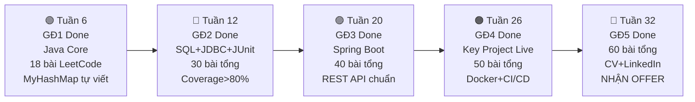

# ⚔️ HIẾN PHÁP HỌC TẬP — JAVA BACKEND INTERN / FRESHER 2027

> **Phiên bản:** 2.0 IRON EDITION  
> **Hiệu lực:** 29/10/2026 → 06/2027  
> **Tính chất:** Đây là tài liệu gốc duy nhất (Single Source of Truth). Bất kỳ mentor/AI/thầy nào tiếp quản đều PHẢI đọc và tuân thủ tài liệu này. Không có ngoại lệ.  
> **Kỹ sư (Mentee):** `junn-noob`  
> **Mục tiêu cuối cùng:** Nhận offer Java Backend Intern/Fresher tại Viettel Digital Talent / VNPay / FPT IS / Rikkeisoft / KMS — Hè 2027  
> **Kế hoạch:** 32 tuần (~7.5 tháng), từ **23/10/2026** đến **06/2027**  
> **Kim chỉ nam:** *"Học sâu bản chất, không học vẹt bề nổi. Kiến thức nào chắc ngay kiến thức đó. Đi từ gốc rễ JVM, OS, Database đến Framework."*

---

## 🔒 13 ĐIỀU LUẬT SẮT (KHÔNG ĐƯỢC VI PHẠM)

> Vi phạm bất kỳ điều nào = buổi học đó **KHÔNG ĐƯỢC TÍNH**, phải học lại.

### NHÓM A — TƯ DUY & BẢN CHẤT

**ĐIỀU 1: Luật Gốc Rễ (Root-First Law)**
> *"Không bao giờ chấp nhận câu trả lời 'vì Java nó thế'. Phải truy đến tận cùng: JVM làm gì? Bộ nhớ xảy ra gì? OS xử lý thế nào?"*

- ❌ "Dùng `private` vì quy ước" → KHÔNG ĐẠT
- ✅ "Dùng `private` vì field trên Heap bị truy xuất bằng byte offset, bất kỳ code nào có reference đều có thể đọc/ghi nếu không có compiler chặn access modifier" → ĐẠT

**ĐIỀU 2: Luật ELI5 (Explain Like I'm Five)**
> *"Mỗi khái niệm cốt lõi phải giải thích được bằng 1 câu mà người không biết lập trình cũng hiểu. Nếu không giải thích đơn giản được = chưa thực sự hiểu."*

**ĐIỀU 3: Luật Không Copy-Paste (Zero Copy Law)**
> *"Tuyệt đối không copy-paste code từ bất kỳ nguồn nào. Mọi dòng code phải tự tay gõ. Được phép đọc tham khảo ý tưởng, sau đó đóng tài liệu lại và tự viết."*

**ĐIỀU 4: Luật Phản Biện Bắt Buộc (Challenge Everything)**
> *"Trong mỗi buổi học, mentee phải đặt ít nhất 2 câu hỏi 'Tại sao?' hoặc 'Nếu làm khác thì sao?' cho mentor."*

### NHÓM B — CODE & CHẤT LƯỢNG

**ĐIỀU 5: Luật Tối Ưu Tuyệt Đối (Optimal-Only Law)**
> *"Mọi bài thuật toán phải đạt giải pháp tối ưu nhất có thể về Time & Space. Brute-force KHÔNG ĐƯỢC CHẤP NHẬN làm bài nộp cuối cùng."*

- Mỗi bài thuật toán bắt buộc: (1) Phân tích pattern → (2) Code tối ưu → (3) Comment Big-O → (4) ≥ 3 test cases (happy + edge + null/empty) → (5) Defensive Programming

**ĐIỀU 6: Luật Phòng Thủ (Defensive Programming Law)**
> *"Mọi public method phải xử lý đầu vào bất hợp lệ. Không bao giờ tin tưởng dữ liệu từ bên ngoài."*

**ĐIỀU 7: Luật Đặt Tên Là Tài Liệu (Names-Are-Docs Law)**
> *"Tên biến, hàm, class phải tự giải thích ý nghĩa. Nếu cần comment để giải thích tên biến đang làm gì = tên chưa đủ tốt."*

### NHÓM C — GIT & PORTFOLIO

**ĐIỀU 8: Luật Nhịp Tim Git (Git Heartbeat Law)**
> *"Mỗi buổi học PHẢI có tối thiểu 3 commits chuẩn Conventional Commits đẩy lên GitHub. Không có commit = buổi học đó không tồn tại."*

- NGHIÊM CẤM commit kiểu `"update"`, `"fix"`, `"done"`, `"abc"`

**ĐIỀU 9: Luật Sơ Đồ Bắt Buộc (Diagram-or-Die Law)**
> *"Mỗi tuần phải có ít nhất 1 sơ đồ kỹ thuật (Class Diagram / Sequence Diagram / ERD) bằng Mermaid trong README."*

### NHÓM D — KỶ LUẬT & TIẾN ĐỘ

**ĐIỀU 10: Luật Warm-up Bất Bại (Warm-up Gate Law)**
> *"Mỗi buổi học BẮT ĐẦU bằng 3-5 câu hỏi ôn tập buổi trước. Trả lời sai > 1 câu = PHẢI ôn lại 30 phút trước khi học kiến thức mới."*

**ĐIỀU 11: Luật Tiến Hóa Ngôn Ngữ (Language Evolution Law)**

| Giai đoạn | Tên biến/hàm/class | Comment trong code | Commit message | README |
|-----------|--------------------|--------------------|----------------|--------|
| GĐ1 (Tuần 1-6) | 🇬🇧 Tiếng Anh | 🇻🇳 Tiếng Việt OK | 🇬🇧 Tiếng Anh | 🇻🇳 Tiếng Việt |
| GĐ2 (Tuần 7-12) | 🇬🇧 Tiếng Anh | 🇬🇧 Tiếng Anh | 🇬🇧 Tiếng Anh | 🇻🇳🇬🇧 Song ngữ |
| GĐ3+ (Tuần 13+) | 🇬🇧 Tiếng Anh | 🇬🇧 Tiếng Anh | 🇬🇧 Tiếng Anh | 🇬🇧 Tiếng Anh (mô tả project) |

**ĐIỀU 12: Luật Nhật Ký Bất Di Bất Dịch (Immutable Log Law)**
> *"Mọi buổi học PHẢI được ghi lại trong README.md đầy đủ. Nhật ký đã ghi KHÔNG ĐƯỢC XÓA hay SỬA lại điểm."*

**ĐIỀU 13: Luật Không Khen Xã Giao (No Sugarcoating Law)**
> *"Mentor NGHIÊM CẤM khen quá lời hoặc dùng các cụm từ thổi phồng. Mentee không cần lời khen — mentee cần sự thật."*

- Nhận xét phải tỉnh táo, lạnh, chính xác — chỉ ra cái đạt, cái chưa đạt, cái cần cải thiện ngay
- **Thang điểm thực tế:**
  - `9-10`: Chuẩn kỹ sư 3-5 năm kinh nghiệm — gần như không khả thi ở giai đoạn đang học
  - `7-8`: Đúng hướng, nhưng vẫn còn lỗ hổng cần bịt
  - `5-6`: Hiểu bề mặt, chưa chạm bản chất — mức phổ biến nhất
  - `<5`: Chưa đạt, phải học lại

---

## 📊 HỆ THỐNG CHẤM ĐIỂM MỖI BUỔI (Áp dụng từ Day 5 trở đi)

| Hạng mục | Điểm tối đa | PASS | ĐẠT TỐT |
|----------|-------------|------|----------|
| Warm-up Quiz | 10 | ≥ 7 | Đúng, giải thích được WHY, không ấp úng |
| Hiểu bản chất (Root-First) | 10 | ≥ 6 | 8+ = tự phát hiện vấn đề trước khi mentor chỉ |
| ELI5 | 10 | ≥ 6 | Diễn đạt đơn giản, đúng bản chất |
| Code OOP / System Design | 10 | ≥ 6 | 8+ = có defensive programming và extensible |
| Thuật toán | 10 | ≥ 6 | 8+ = tự xử lý mọi edge case |
| Git Commits | 10 | ≥ 6 | 8+ = commit history kể được câu chuyện |
| **Tổng** | **60** | **≥ 36** | **≥ 48 (hiếm khi xảy ra)** |

> **Trung bình 6-7/10 mỗi hạng mục = đang đi đúng tốc độ.** Không cần 9-10 mới là tốt.  
> **9-10/10 gần như không tồn tại** ở giai đoạn đang học. 10/10 = chuẩn Senior 5+ năm.

---

## 📝 NHẬT KÝ HỌC TẬP

> **Lưu ý:** Day 1 → Day 4 được ghi theo hệ thống chấm điểm cũ (v1) — thang điểm lỏng hơn, có khen xã giao. Từ Day 5 trở đi áp dụng hệ thống v2 (IRON EDITION) với thang điểm thực tế và nhận xét thẳng thắn.

### 📅 BUỔI 1 (DAY 1 - 23/10/2026): Khởi động, JVM Internals, Tính Đóng Gói & Giải Thuật Mảng

#### 1. Kiến thức cốt lõi đã làm chủ:
* **Hạ tầng & Luồng thực thi:** Cấu hình thành công JDK 21 LTS (`jdk-21.0.12.1`), hiểu sâu luồng biên dịch `.java` ➔ `javac` ➔ Bytecode (`.class`) ➔ JVM (Interpreter & JIT Compiler) ➔ CPU.
* **Bản chất 2 vùng nhớ tối thượng:** 
  * **Stack:** Lưu trữ Stack Frames, biến cục bộ nguyên thủy, biến tham chiếu; cơ chế LIFO, giải phóng tức thì; nhận diện lỗi `StackOverflowError`.
  * **Heap:** Lưu trữ Object thật sự, mảng, String Pool; cơ chế cấp phát động khi `new`, giải phóng bởi Garbage Collector (GC); nhận diện lỗi `OutOfMemoryError: Java heap space`.
* **Quy tắc Definite Assignment trong Java Compiler:**
  * Giải thích cặn kẽ vì sao biến cục bộ trong hàm nếu chưa khởi tạo mà dùng thì bị `javac` chặn lỗi ngay lập tức (phân tích luồng để triệt tiêu lỗi ngầm - Silent Bug).
  * Hiểu vì sao thuộc tính trên Heap tự động nhận giá trị mặc định (`0`, `null`, `false`) để đảm bảo an toàn bộ nhớ (Zeroing memory tránh đọc rác cũ).
* **Cơ chế Pass-by-Value tuyệt đối:** Hiểu thấu đáo Java 100% truyền bản sao giá trị (kể cả Object là truyền bản sao của địa chỉ ô nhớ).
* **Tính bất biến (Immutability):** Phân tích cơ chế ô nhớ của `String` và các Wrapper Class (`Integer`, `Double`...), cơ chế Autoboxing/Unboxing và bẫy Integer Cache (-128 đến 127).
* **Hệ thống tiền tố (Modifiers) trong Java:** Phân biệt và ứng dụng thực tế `public`, `private`, `protected`, `static`, `final`, `abstract`, và lý do vì sao Java không cần từ khóa `virtual`.

#### 2. Sản phẩm & Thuật toán đã nghiệm thu:
* [x] **[BankAccount.java](file:///c:/Users/hungn/OneDrive/Documents/Java/GiaiDoan1/day01/BankAccount.java):** Hiện thực tính đóng gói (Encapsulation), bảo vệ trạng thái số dư, chống rút tiền âm, xử lý an toàn dữ liệu đầu vào chống `NullPointerException`.
* [x] **[Main.java](file:///c:/Users/hungn/OneDrive/Documents/Java/GiaiDoan1/day01/Main.java):** Kịch bản kiểm thử toàn diện các tình huống hợp lệ và các cuộc tấn công dữ liệu biên.
* [x] **[StockProfit.java](file:///c:/Users/hungn/OneDrive/Documents/Java/GiaiDoan1/day01/StockProfit.java) (LeetCode #121):** Giải thuật tối ưu One-Pass — $O(N)$ Time, $O(1)$ Space. Có Defensive Programming chặn mảng rỗng/null.

#### 3. Đánh giá (hệ thống v1 — thang cũ):
* Điểm tư duy kiến trúc & bộ nhớ: `8.5 / 10`
* Điểm giải thuật & tối ưu Big-O: `10 / 10`

---

### 📅 BUỔI 2 (DAY 2 - 24/10/2026): Tính Kế Thừa (Inheritance), Template Method Pattern & Kỹ Thuật Hai Con Trỏ

#### 1. Kiến thức cốt lõi đã làm chủ:
* **Bản chất vùng nhớ Heap trong Kế thừa:** Object con chứa trọn vẹn toàn bộ các trường của cha (kể cả trường `private`) trên Heap; từ khóa `private` chỉ là hàng rào kiểm soát ở tầng compiler.
* **Cơ chế Constructor Chaining & Quy tắc ngầm:**
  * Thứ tự thực thi: Lớp Cha luôn phải khởi tạo xong xuôi (`super()`) trước khi lớp Con bắt đầu thực thi.
  * Trong một constructor, dòng đầu tiên chỉ được chọn **HOẶC `super(...)` HOẶC `this(...)`**, không bao giờ được cả hai.
* **Phân tích chiều sâu Kiến trúc `protected` vs `private`:**
  * Chỉ ra lỗ hổng lớn của `protected field`: Bất kỳ class nào trong cùng package đều có thể can thiệp và làm vỡ tính đóng gói của Cha.
  * Hiểu rõ nguyên tắc Joshua Bloch: *"Fields are private, protected is only for methods"*.
* **Làm chủ Template Method Pattern:** Tách biệt quyền hạn: Cha độc quyền giữ biến `balance` và thực hiện trừ tiền trong `withdraw()`, Con chỉ việc override hàm điều kiện `canWithdraw()`.
* **Dynamic Method Dispatch & Runtime Polymorphism:** Cơ chế JVM dựa vào bảng ảo `vtable` để chạy đúng phương thức của đối tượng thực tế trên Heap lúc Runtime.
* **Quy tắc bất biến khi Method Overriding:** Widening OK (`protected` ➔ `public`), Narrowing CẤM (`protected` ➔ `private`) — Liskov Substitution Principle.

#### 2. Sản phẩm & Thuật toán đã nghiệm thu:
* [x] **[ServerLog.java](file:///c:/Users/hungn/OneDrive/Documents/Java/GiaiDoan1/day02/ServerLog.java):** Defensive Copying mảng 2 chiều (Cửa Vào & Cửa Ra).
* [x] **[SavingsAccount.java](file:///c:/Users/hungn/OneDrive/Documents/Java/GiaiDoan1/day02/SavingsAccount.java):** Kế thừa `BankAccount`, nạp lãi suất và chặn rút dưới số dư tối thiểu 50k.
* [x] **[CheckingAccount.java](file:///c:/Users/hungn/OneDrive/Documents/Java/GiaiDoan1/day02/CheckingAccount.java):** Template Method Pattern, hỗ trợ thấu chi 2 triệu VNĐ, tự động trừ phí 5k.
* [x] **[MoveZeroes.java](file:///c:/Users/hungn/OneDrive/Documents/Java/GiaiDoan1/day02/MoveZeroes.java) (LeetCode #283):** Two Pointers In-place — $O(N)$ Time, $O(1)$ Space.
* [x] **[Main.java](file:///c:/Users/hungn/OneDrive/Documents/Java/GiaiDoan1/day02/Main.java):** Bộ test 4 kịch bản, pass 100%.

#### 3. Đánh giá (hệ thống v1 — thang cũ):
* Điểm tư duy kiến trúc & phản biện: `10 / 10`
* Điểm giải thuật & In-place Big-O: `10 / 10`

---

### 📅 BUỔI 3 (DAY 3 - 25/10/2026): Tính Trừu Tượng (Abstraction), Đa Hình (Polymorphism) & Master Review Tuần 1

#### 1. Kiến thức cốt lõi đã làm chủ:
* **Abstract Class vs Interface:** `Abstract Class` = IS-A + chia sẻ State; `Interface` = CAN-DO (hợp đồng năng lực).
* **Tính Đa Hình & vtable:** Compile-time kiểm tra chữ ký → Runtime dispatch qua vtable của đối tượng thực sự trên Heap.
* **Ôn tập tổng kết Tuần 1 (Master Quiz):** 4 tình huống thực chiến, điểm `39 / 40`.

#### 2. Sản phẩm & Thuật toán đã nghiệm thu:
* [x] **[PaymentMethod.java](file:///c:/Users/hungn/OneDrive/Documents/Java/GiaiDoan1/day03/PaymentMethod.java):** Interface hợp đồng thanh toán.
* [x] **[BasePayment.java](file:///c:/Users/hungn/OneDrive/Documents/Java/GiaiDoan1/day03/BasePayment.java):** Abstract class quản lý mã giao dịch và số tiền.
* [x] **[CreditCardPayment.java](file:///c:/Users/hungn/OneDrive/Documents/Java/GiaiDoan1/day03/CreditCardPayment.java):** Thanh toán thẻ tín dụng, phí 2%.
* [x] **[MoMoPayment.java](file:///c:/Users/hungn/OneDrive/Documents/Java/GiaiDoan1/day03/MoMoPayment.java):** Thanh toán ví MoMo, 0% phí.
* [x] **[PaymentProcessor.java](file:///c:/Users/hungn/OneDrive/Documents/Java/GiaiDoan1/day03/PaymentProcessor.java):** Xử lý thanh toán đa hình duyệt `PaymentMethod[]`.
* [x] **[ValidPalindrome.java](file:///c:/Users/hungn/OneDrive/Documents/Java/GiaiDoan1/day03/ValidPalindrome.java) (LeetCode #125):** Two Pointers Left & Right — $O(N)$ Time, $O(1)$ Space.
* [x] **[Main.java](file:///c:/Users/hungn/OneDrive/Documents/Java/GiaiDoan1/day03/Main.java):** Test đa hình + 6 test cases thuật toán, pass 100%.

#### 3. Đánh giá (hệ thống v1 — thang cũ):
* Điểm tư duy kiến trúc & OOP: `10 / 10`
* Điểm giải thuật & tối ưu Big-O: `10 / 10`
* Điểm kiểm tra tuần: `9.75 / 10` (39/40)

---

### 🏆 CAPSTONE PROJECT TUẦN 1: HỆ THỐNG GIAO VẬN E-COMMERCE

Tích hợp 4 trụ cột OOP, Template Method Pattern, 2-Way Defensive Copying và Hai Con Trỏ In-Place:
* [x] **[Shippable.java](file:///c:/Users/hungn/OneDrive/Documents/Java/GiaiDoan1/review01/Shippable.java):** Interface năng lực tính phí & giao vận.
* [x] **[BaseOrder.java](file:///c:/Users/hungn/OneDrive/Documents/Java/GiaiDoan1/review01/BaseOrder.java):** Abstract class + Template Method `processOrder()` + Defensive Copying 2 chiều.
* [x] **[StandardOrder.java](file:///c:/Users/hungn/OneDrive/Documents/Java/GiaiDoan1/review01/StandardOrder.java), [ExpressOrder.java](file:///c:/Users/hungn/OneDrive/Documents/Java/GiaiDoan1/review01/ExpressOrder.java), [VIPOrder.java](file:///c:/Users/hungn/OneDrive/Documents/Java/GiaiDoan1/review01/VIPOrder.java):** Đa hình quy tắc nghiệp vụ.
* [x] **[OrderProcessor.java](file:///c:/Users/hungn/OneDrive/Documents/Java/GiaiDoan1/review01/OrderProcessor.java):** Xử lý hàng loạt qua đa hình thuần.
* [x] **[OrderUtils.java](file:///c:/Users/hungn/OneDrive/Documents/Java/GiaiDoan1/review01/OrderUtils.java):** Two Pointers lọc In-place.
* [x] **[Main.java](file:///c:/Users/hungn/OneDrive/Documents/Java/GiaiDoan1/review01/Main.java):** 3 kịch bản test, pass 100%.

---

### 📅 BUỔI 4 (DAY 4 - 28/10/2026): 5 Nguyên Lý Thiết Kế SOLID (Phần 1: S - O - L) & Giải Thuật Hai Con Trỏ Nâng Cao

#### 1. Kiến thức cốt lõi đã làm chủ:
* **S (Single Responsibility):** Mỗi class chỉ có duy nhất một lý do để thay đổi. Tách Data Model/Entity khỏi Processing Service.
* **O (Open-Closed):** Mở rộng bằng Interface & Đa hình, đóng cửa code cũ đã chạy ổn.
* **L (Liskov Substitution):** Lớp con thay thế hoàn toàn lớp cha mà không làm hỏng tính đúng đắn.
* **Nghịch lý Rectangle & Square:** Tái hiện bug `Square extends Rectangle`, refactor sang Interface `Shape` độc lập.
* **Field Shadowing vs Method Overriding:** Field = Compile-time theo kiểu khai báo; Method = Runtime theo đối tượng thực trên Heap.

#### 2. Sản phẩm & Thuật toán đã nghiệm thu:
* [x] **[Shape.java](file:///c:/Users/hungn/OneDrive/Documents/Java/GiaiDoan1/day04/Shape.java):** Interface hình học với `getArea()`.
* [x] **[Rectangle.java](file:///c:/Users/hungn/OneDrive/Documents/Java/GiaiDoan1/day04/Rectangle.java):** Hình chữ nhật `implements Shape`.
* [x] **[Square.java](file:///c:/Users/hungn/OneDrive/Documents/Java/GiaiDoan1/day04/Square.java):** Hình vuông `implements Shape`, 1 cạnh `side`.
* [x] **[TwoSumSorted.java](file:///c:/Users/hungn/OneDrive/Documents/Java/GiaiDoan1/day04/TwoSumSorted.java) (LeetCode #167):** Two Pointers hội tụ — $O(N)$ Time, $O(1)$ Space.
* [x] **[Main.java](file:///c:/Users/hungn/OneDrive/Documents/Java/GiaiDoan1/day04/Main.java):** Test LSP + 3 test cases thuật toán, pass 100%.

#### 3. Đánh giá (hệ thống v1 — thang cũ):
* Điểm tư duy kiến trúc & SOLID: `10 / 10`
* Điểm giải thuật & tối ưu Big-O: `10 / 10`

---

### 📅 BUỔI 5 (DAY 5 - 30/10/2026): Hoàn Thiện Bộ Nguyên Lý SOLID (I & D) & Thuật Toán Tối Ưu Diện Tích

#### 1. Kiến thức cốt lõi đã làm chủ:
* **I (Interface Segregation Principle - ISP):**
  * Tác hại của Fat Interface: Ép client implement những method vô nghĩa dẫn đến vi phạm cả LSP (ném `UnsupportedOperationException`).
  * Giải pháp Role Interfaces: Tách thành các Interface độc lập đại diện cho năng lực (`Switchable`, `Dimmable`, `Thermostat`).
  * Tránh Over-engineering / Interface Explosion: Chỉ tách khi có từ 2 nhóm Client với nhu cầu khác nhau.
* **D (Dependency Inversion Principle - DIP):**
  * Bản chất: High-level module không phụ thuộc Low-level module; cả 2 phụ thuộc Abstraction.
  * Phân biệt Tightly-Coupled (`new` cứng trong class) vs Loosely-Coupled (qua Interface).
  * Thực hành **Constructor Injection** làm tiền đề cho Spring Framework IoC/DI ở Giai đoạn 3.
* **Khai sáng cơ chế Access Modifier trong Java:**
  * Đập tan hiểu lầm: Java khi không ghi gì là `package-private`, **hoàn toàn không phải `private`**.
  * Khắc sâu nguyên tắc: Luôn tường minh `private` cho mọi instance field để bảo vệ tính đóng gói.

#### 2. Sản phẩm & Thuật toán đã nghiệm thu:
* [x] **[Switchable.java](file:///c:/Users/hungn/OneDrive/Documents/Java/GiaiDoan1/day05/Switchable.java):** Interface công tắc bật/tắt.
* [x] **[Dimmable.java](file:///c:/Users/hungn/OneDrive/Documents/Java/GiaiDoan1/day05/Dimmable.java):** Interface điều chỉnh độ sáng 0 - 100%.
* [x] **[Thermostat.java](file:///c:/Users/hungn/OneDrive/Documents/Java/GiaiDoan1/day05/Thermostat.java):** Interface điều chỉnh nhiệt độ 16 - 30°C.
* [x] **[SmartLight.java](file:///c:/Users/hungn/OneDrive/Documents/Java/GiaiDoan1/day05/SmartLight.java), [AirConditioner.java](file:///c:/Users/hungn/OneDrive/Documents/Java/GiaiDoan1/day05/AirConditioner.java), [SmartPlug.java](file:///c:/Users/hungn/OneDrive/Documents/Java/GiaiDoan1/day05/SmartPlug.java):** Các thiết bị IoT tuân thủ ISP.
* [x] **[SmartHomeController.java](file:///c:/Users/hungn/OneDrive/Documents/Java/GiaiDoan1/day05/SmartHomeController.java):** Bộ điều khiển trung tâm áp dụng DIP qua Constructor Injection và Defensive Copying mảng an toàn.
* [x] **[ContainerWithMostWater.java](file:///c:/Users/hungn/OneDrive/Documents/Java/GiaiDoan1/day05/ContainerWithMostWater.java) (LeetCode #11):**
  * Two Pointers dịch chuyển cột thấp hơn — $O(N)$ Time, $O(1)$ Space.
  * Tự chứng minh toán học: Dịch cột cao hơn chỉ làm giảm diện tích.
* [x] **[Main.java](file:///c:/Users/hungn/OneDrive/Documents/Java/GiaiDoan1/day05/Main.java):** Kịch bản kiểm thử toàn diện ISP, DIP, Null Safety và LeetCode #11 (Pass 100%).

#### 3. Đánh giá (Hệ thống v2 - IRON EDITION):
* **Warm-up Quiz:** `6.2 / 10` (Đạt ngưỡng mở cửa; cần sâu sắc hơn khi giải thích lý do hệ thống crash ở LSP)
* **Hiểu bản chất (Root-First):** `6.5 / 10` (Hiểu cốt lõi ISP và DIP; đã xóa bỏ hiểu lầm về access modifier mặc định của Java)
* **ELI5:** `4.0 / 10` (Ví dụ ban đầu bị nhầm sang Inheritance và Adapter; cần rèn luyện cách ví von đời thường chuẩn xác hơn)
* **Code OOP / System Design:** `7.0 / 10` (Kiến trúc phân tách Interface và Constructor Injection đúng; cần chú ý tính cẩn trọng khi gán giá trị trong constructor)
* **Thuật toán:** `9.0 / 10` (Chứng minh toán học chính xác, code Two Pointers tối ưu và có defensive check)
* **Git Commits:** `7.0 / 10` (Tuân thủ Conventional Commits)
* **Tổng điểm Day 5:** `39.7 / 60` — **XẾP LOẠI: PASS (Đang đi đúng tiến độ)**

---

### 🏆 CAPSTONE CHALLENGE: HỆ THỐNG ĐỐI SOÁT TÀI CHÍNH (`GiaiDoan1.challenge01`)

Tích hợp toàn diện 100% kiến thức Day 1 -> Day 5: 4 trụ cột OOP, trọn bộ 5 nguyên lý SOLID, Template Method, 2-Way Defensive Copying và Two Pointers Closest Pair ($O(N)$ Time, $O(1)$ Space):
* [x] **[Payable.java](file:///c:/Users/hungn/OneDrive/Documents/Java/GiaiDoan1/challenge01/Payable.java), [Refundable.java](file:///c:/Users/hungn/OneDrive/Documents/Java/GiaiDoan1/challenge01/Refundable.java):** Chuẩn Interface Segregation Principle (ISP) - tách năng lực thanh toán và hoàn tiền riêng biệt.
* [x] **[BaseAccount.java](file:///c:/Users/hungn/OneDrive/Documents/Java/GiaiDoan1/challenge01/BaseAccount.java):** Khung xương Template Method Pattern, trừ đúng phí giao dịch và tự động cập nhật lịch sử bằng `System.arraycopy`.
* [x] **[BankAccount.java](file:///c:/Users/hungn/OneDrive/Documents/Java/GiaiDoan1/challenge01/BankAccount.java):** Kế thừa `BaseAccount`, implements `Refundable`, phí cố định 5.000 VNĐ.
* [x] **[CryptoWallet.java](file:///c:/Users/hungn/OneDrive/Documents/Java/GiaiDoan1/challenge01/CryptoWallet.java):** Tuân thủ ISP (không có hoàn tiền), phí 2%, chặn rút dưới số dư tối thiểu 100.000 VNĐ.
* [x] **[SettlementEngine.java](file:///c:/Users/hungn/OneDrive/Documents/Java/GiaiDoan1/challenge01/SettlementEngine.java):** Đảo ngược phụ thuộc (DIP) qua Constructor Injection `Payable[]`, đối soát hàng loạt chính xác chỉ đếm giao dịch thành công.
* [x] **[TransactionAuditor.java](file:///c:/Users/hungn/OneDrive/Documents/Java/GiaiDoan1/challenge01/TransactionAuditor.java):** Thuật toán Two Pointers tìm cặp giao dịch gần `target` nhất ($O(N)$ Time, $O(1)$ Space), xử lý triệt để bẫy 2 đầu và chênh lệch tối thiểu bằng `Math.abs`.
* [x] **[Main.java](file:///c:/Users/hungn/OneDrive/Documents/Java/GiaiDoan1/challenge01/Main.java):** Kịch bản kiểm thử khắc nghiệt 6 đòn kiểm tra: Refund, Trừ phí, Crypto limit, Đối soát batch, Thuật toán Two Pointers (3 test cases), Hack bộ nhớ mảng (Pass 100%).

---

### 🏆 CAPSTONE CHALLENGE 02: HỆ THỐNG THU PHÍ TỰ ĐỘNG KHÔNG DỪNG ETC (`GiaiDoan1.challenge02`)

Mô phỏng thực tế kiến trúc trạm thu phí VETC / ePass tích hợp ISP, Ép kiểu Interface (Interface Pattern Matching), Đa hình động và Thuật toán 3 con trỏ Dutch National Flag (LeetCode #75 - $O(N)$ Time, $O(1)$ Space):
* [x] **[TollPayable.java](file:///c:/Users/hungn/OneDrive/Documents/Java/GiaiDoan1/challenge02/TollPayable.java), [RFIDReadable.java](file:///c:/Users/hungn/OneDrive/Documents/Java/GiaiDoan1/challenge02/RFIDReadable.java), [EmergencyVehicle.java](file:///c:/Users/hungn/OneDrive/Documents/Java/GiaiDoan1/challenge02/EmergencyVehicle.java):** Chuẩn Interface Segregation Principle (ISP) - tách biệt rạch ròi giữa định danh phần cứng (thẻ RFID), tài khoản thanh toán và quyền ưu tiên công vụ.
* [x] **[BaseVehicle.java](file:///c:/Users/hungn/OneDrive/Documents/Java/GiaiDoan1/challenge02/BaseVehicle.java):** Lớp cha trừu tượng quản lý biển số, tải trọng đăng kiểm và hàm tính phí trừu tượng `calculateBaseToll()`.
* [x] **[StandardCar.java](file:///c:/Users/hungn/OneDrive/Documents/Java/GiaiDoan1/challenge02/StandardCar.java):** Xe con phí cố định 35.000 VNĐ, quản lý riêng biệt mã thẻ RFID và mã tài khoản thanh toán.
* [x] **[HeavyTruck.java](file:///c:/Users/hungn/OneDrive/Documents/Java/GiaiDoan1/challenge02/HeavyTruck.java):** Xe tải tính phí lũy tiến tải trọng thực tế, tự động phạt thêm 100% phí gốc nếu phát hiện chở quá tải (`actualWeight > registeredWeight`).
* [x] **[Ambulance.java](file:///c:/Users/hungn/OneDrive/Documents/Java/GiaiDoan1/challenge02/Ambulance.java):** Xe cứu thương ưu tiên, phí 0 VNĐ, không tài khoản, không RFID.
* [x] **[TollBoothController.java](file:///c:/Users/hungn/OneDrive/Documents/Java/GiaiDoan1/challenge02/TollBoothController.java):** Module điều khiển thanh chắn Barie qua Constructor Injection `BaseVehicle[]`, sử dụng Interface Downcasting kiểm tra hợp lệ và điều khiển mở/đóng Barie chính xác.
* [x] **[TrafficController.java](file:///c:/Users/hungn/OneDrive/Documents/Java/GiaiDoan1/challenge02/TrafficController.java) (LeetCode #75):**
  * Thuật toán 3 con trỏ Dutch National Flag (`low`, `mid`, `high`) phân luồng làn xe $O(N)$ One-Pass, $O(1)$ Space In-place hoán đổi trực tiếp không dùng Counting Sort.
  * Có Defensive Check phòng thủ mảng `null` và độ dài $\le 1$.
* [x] **[Main.java](file:///c:/Users/hungn/OneDrive/Documents/Java/GiaiDoan1/challenge02/Main.java):** Kịch bản kiểm thử toàn diện Barie, xử phạt quá tải, chặn xe thẻ hỏng/hết tiền, và 4 kịch bản thuật toán phân luồng (Pass 100%).

---

## 📅 LỘ TRÌNH CHI TIẾT 32 TUẦN

> Mỗi checkpoint là 1 cánh cửa. **Không đạt = không được sang giai đoạn tiếp.**

### GIAI ĐOẠN 1: JAVA CORE DEEP DIVE & BẢN CHẤT HỆ THỐNG
*Tuần 1-6 (23/10/2026 → 04/12/2026)*

#### Tuần 1 ✅ (Đã hoàn thành)
- [x] JVM Internals, Stack vs Heap, Pass-by-Value, Definite Assignment
- [x] 4 tính chất OOP: Encapsulation, Inheritance, Polymorphism, Abstraction
- [x] Template Method Pattern, Defensive Copying, vtable
- [x] Thuật toán: #121, #283, #125
- [x] Capstone: Hệ thống giao vận E-commerce

#### Tuần 2 (28/10 → 01/11/2026) — SOLID hoàn chỉnh & String Internals
| Buổi | OOP/Design | Thuật toán | Output |
|------|-----------|------------|--------|
| Day 4 ✅ | S, O, L + LSP Rectangle/Square | #167 Two Sum II | Đã hoàn thành |
| Day 5 ✅ | **I (Interface Segregation) + D (Dependency Inversion)** | #11 Container With Most Water | Code ISP/DIP + thuật toán |
| Day 6 | **String Deep Dive:** String Pool, `intern()`, StringBuilder vs StringBuffer | #3 Longest Substring Without Repeating (**Sliding Window**) | Code demo String Pool |
| Review 02 | Capstone Tuần 2: Hệ thống áp dụng đủ 5 SOLID | — | Project + Class Diagram |

#### Tuần 3 (03/11 → 08/11/2026) — Exception Handling & Enum
| Buổi | Core | Thuật toán | Output |
|------|------|------------|--------|
| Day 7 | **Exception:** Checked vs Unchecked, Call Stack Unwinding, `try-with-resources` | #206 Reverse Linked List | Custom Exception hierarchy |
| Day 8 | **Enum & Static:** Enum internals (singleton trên Heap), Static loading order | #21 Merge Two Sorted Lists | State Machine bằng Enum |
| Day 9 | **Nested Classes & Lambda Preview:** Inner → Anonymous → Lambda | #876 Middle of Linked List | Observer Pattern |
| Review 03 | Bug Hunter Session #1: Đọc 3 đoạn code có bug | Tổng hợp | Sửa bug + giải thích gốc rễ |

#### Tuần 4 (10/11 → 15/11/2026) — Collections Internals (Phần 1)
| Buổi | Core | Thuật toán | Output |
|------|------|------------|--------|
| Day 10 | **ArrayList Deep Dive:** resize 1.5x, amortized O(1). **Tự cài `MyArrayList<E>`** | #20 Valid Parentheses (Stack) | `MyArrayList.java` |
| Day 11 | **LinkedList Deep Dive:** Node trên Heap, Cache locality. **Tự cài `MySinglyLinkedList<E>`** | #155 Min Stack | `MySinglyLinkedList.java` |
| Day 12 | **Iterator Pattern, `Comparable`/`Comparator`:** Implement `Iterable<E>` cho MyArrayList | #242 Valid Anagram (HashMap counting) | Iterator + Comparator |
| Review 04 | Capstone: Ứng dụng dùng MyArrayList tự viết (không java.util) | — | Project + sơ đồ |

#### Tuần 5 (17/11 → 22/11/2026) — Collections Internals (Phần 2)
| Buổi | Core | Thuật toán | Output |
|------|------|------------|--------|
| Day 13 | **HashMap Deep Dive:** Bucket, hash, collision, load factor 0.75, Red-Black Tree (8). **Tự cài `MyHashMap<K,V>`** | #1 Two Sum (HashMap) | `MyHashMap.java` |
| Day 14 | **Hợp đồng `equals()` & `hashCode()`:** 5 quy tắc, bẫy khi quên override | #49 Group Anagrams | Demo equals/hashCode |
| Day 15 | **TreeMap/TreeSet, HashSet:** Red-Black Tree concept, NavigableMap | #347 Top K Frequent Elements | Benchmark HashMap vs TreeMap |
| Review 05 | Bug Hunter #2 + Capstone: Ứng dụng dùng MyHashMap tự viết | — | Project + benchmark |

#### Tuần 6 (24/11 → 04/12/2026) — Modern Java & GĐ1 FINAL
| Buổi | Core | Thuật toán | Output |
|------|------|------------|--------|
| Day 16 | **Generics:** Type Erasure, Wildcards, PECS Rule | #704 Binary Search | Refactor MyArrayList/MyHashMap Generics |
| Day 17 | **Lambda & Functional Interface:** `@FunctionalInterface`, method reference, `Predicate/Function/Consumer/Supplier` | #33 Search in Rotated Sorted Array | Function composition pipeline |
| Day 18 | **Stream API:** Lazy evaluation, `collect()`, `reduce()`, parallel stream pitfalls, `Optional` | #75 Sort Colors (Dutch National Flag) | Refactor for-loop → Stream |
| Day 19 | **Java 17-21:** `record`, `sealed class`, pattern matching, switch expression | — | Refactor code cũ modern syntax |
| 🏆 FINAL | **CAPSTONE GĐ1:** Console app chuẩn SOLID, Collections tự cài, Stream, Generics, modern Java | — | Full project + Class Diagram |

### GIAI ĐOẠN 2: DATABASE, JDBC & TESTING
*Tuần 7-12 (05/12/2026 → 15/01/2027)*

#### Tuần 7-8: RDBMS & SQL
- PostgreSQL, DDL/DML, Chuẩn hóa 1NF-3NF, ERD
- JOINs, GROUP BY, HAVING, Subquery, CTE, Window Functions
- ACID, Isolation Levels, demo Dirty Read / Phantom Read
- ≥ 10 bài LeetCode SQL (#175, #176, #177, #178, #181...)

#### Tuần 9: Indexing & Query Optimization
- B+Tree, Clustered vs Non-Clustered, Composite Index
- `EXPLAIN ANALYZE`, JDBC `PreparedStatement`, SQL Injection demo

#### Tuần 10: Build Tools & JDBC Production
- Maven `pom.xml`, Gradle cơ bản, HikariCP Connection Pool
- DAO Pattern, Flyway database migration

#### Tuần 11-12: Testing & GĐ2 Final
- JUnit 5, Mockito, Integration Test vs Unit Test
- Thuật toán: Stack, Queue, Binary Search (≥ 6 bài)
- 🏆 CAPSTONE GĐ2: Java + JDBC + PostgreSQL + DAO + HikariCP + Flyway + JUnit, coverage > 80%

### GIAI ĐOẠN 3: SPRING BOOT & KIẾN TRÚC BACKEND
*Tuần 13-20 (16/01/2027 → 12/03/2027)*

#### Tuần 13-14: Spring Core & IoC
- IoC Container, Bean Lifecycle, DI (Constructor Injection), Bean Scopes
- Spring AOP, `@Transactional` internals, Profiles & Config

#### Tuần 15-16: RESTful API
- Layered Architecture (Controller → Service → Repository → DTO)
- Bean Validation, Global Exception Handling, Logging (SLF4J + Logback)
- SpringDoc OpenAPI, Thuật toán: Tree, Graph (≥ 4 bài)

#### Tuần 17-18: Spring Data JPA & Hibernate
- Entity States, Relationships, **Vấn đề N+1** (JOIN FETCH / @EntityGraph)
- Pagination, Specification, Flyway + JPA, Auditing

#### Tuần 19-20: Security, Caching & GĐ3 Final
- Spring Security 6, JWT (Access + Refresh Token), OAuth2 cơ bản
- Redis Caching, Rate Limiting
- 🏆 CAPSTONE GĐ3: REST API + Security + JWT + JPA (không N+1) + Redis + Swagger

### GIAI ĐOẠN 4: DỰ ÁN THỰC CHIẾN & DEVOPS
*Tuần 21-26 (13/03/2027 → 23/04/2027)*

#### Tuần 21-22: Key Project Design & Sprint 1
- Requirements, System Design, DB Schema, Concurrency Control (Locking)

#### Tuần 23-24: Advanced Features & Sprint 2-3
- RabbitMQ/Kafka, WebSocket, Technical Blog (2-3 bài Viblo/Dev.to)

#### Tuần 25-26: DevOps & Deploy
- Docker, CI/CD (GitHub Actions), Prometheus + Grafana
- Deploy live lên Cloud
- 🏆 CAPSTONE GĐ4: Full project, Dockerized, CI/CD, live demo, benchmark

### GIAI ĐOẠN 5: PHỎNG VẤN & SĂN JOB
*Tuần 27-32 (24/04/2027 → 05/06/2027)*

- CV chuẩn ATS, LinkedIn, GitHub profile
- Mock Interview: Java Core 50 câu, Spring Boot + DB 50 câu
- System Design cơ bản, Behavioral Interview (STAR)
- Nộp hồ sơ + Phỏng vấn → 🎯 **NHẬN OFFER**

---

## 📈 BẢNG THUẬT TOÁN BẮT BUỘC (~60 BÀI)

| Pattern | Số bài | GĐ | Bài tiêu biểu |
|---------|--------|----|----------------|
| Array / One-Pass | 5 | 1 | #121, #283, #75 |
| Two Pointers | 6 | 1 | #125, #167, #11, #15 |
| Sliding Window | 4 | 1 | #3, #209, #438 |
| HashMap / Counting | 5 | 1-2 | #1, #242, #49, #347 |
| Stack / Queue | 4 | 1-2 | #20, #155, #232 |
| Linked List | 4 | 1 | #206, #21, #876, #141 |
| Binary Search | 4 | 1-2 | #704, #33, #34 |
| Tree (BFS/DFS) | 5 | 3 | #104, #226, #102, #98 |
| Graph | 3 | 3 | #200, #133 |
| Dynamic Programming | 5 | 3-4 | #70, #198, #322, #300 |
| Greedy | 3 | 4 | #55, #134 |
| SQL (LeetCode DB) | 10 | 2 | #175, #176, #177, #178, #181 |
| **TỔNG** | **~60+** | | |

---

## 🔄 QUY TRÌNH CHUYỂN GIAO MENTOR (HANDOVER PROTOCOL)

> Nếu mentor hiện tại không thể tiếp tục, mentor mới PHẢI:

### Bước 1: Đọc tài liệu (30 phút)
- Đọc toàn bộ README.md này — cả 13 Điều Luật và Nhật Ký Học Tập

### Bước 2: Kiểm tra năng lực (1 buổi)
- 5-10 câu hỏi bao phủ kiến thức đã học
- 1 bài thuật toán live (không Google)
- Review code gần nhất trên GitHub

### Bước 3: Tiếp tục từ đúng vị trí
- Bắt đầu từ buổi tiếp theo trong lộ trình (không lặp, không nhảy)
- Tuân thủ 13 Điều Luật — không được nới lỏng
- Ghi nhật ký tiếp nối vào README.md

### Thông tin về mentee:
- **Phong cách:** Tiếp thu nhanh, thích phản biện, có tiềm năng tư duy kiến trúc nhưng còn non
- **Điểm mạnh hiện tại:** Nắm cơ chế JVM/bộ nhớ ở mức cơ bản, thuật toán mảng/chuỗi đơn giản ổn
- **Điểm yếu cần đẩy:** Git workflow chưa có thói quen, chưa quen vẽ sơ đồ, tiếng Anh kỹ thuật còn yếu, chưa đọc/debug code người khác
- **Cách giao tiếp:** Gọi mentor là "sếp/xếp", muốn được thúc đẩy mạnh, **KHÔNG khen xã giao** — chỉ nhận xét thẳng, chỉ ra lỗ hổng
- **Mindset:** Biết mình đang thua xa nhiều người, muốn đuổi kịp bằng kỷ luật chứ không bằng ảo tưởng
