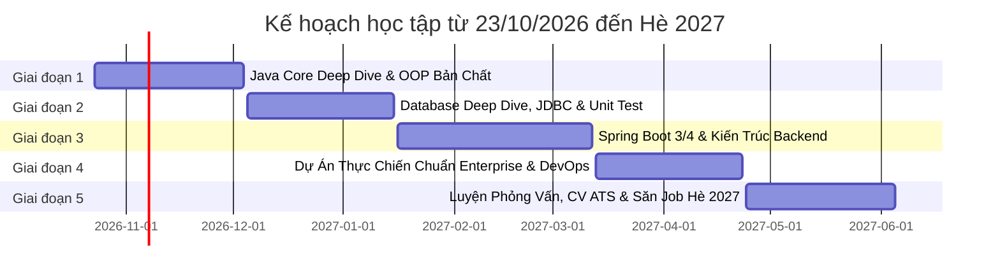

# ☕ JAVA BACKEND INTERN & FRESHER 2027

> **Mục tiêu:** Chinh phục vị trí **Java Backend Intern / Fresher** tại các tập đoàn và công ty công nghệ lớn (Viettel Digital Talent, Vingroup/VinFast, FPT IS, Rikkeisoft, VNPay, ZaloPay, KMS...) vào mùa tuyển dụng Hè 2027 (tháng 5 – 7/2027).  
> **Kế hoạch:** 32 tuần (~7.5 tháng), từ **23/10/2026** đến **06/2027**.  
> **Kim chỉ nam:** *"Học sâu bản chất, không học vẹt bề nổi. Kiến thức nào chắc ngay kiến thức đó. Đi từ gốc rễ JVM, OS, Database đến Framework."*  
> **Kỹ sư (Mentee):** `junn-noob`  
> **Tech Lead / Quản lý kỹ thuật:** `Antigravity`

---

## 📝 NHẬT KÝ HỌC TẬP & ĐÁNH GIÁ NĂNG LỰC TỪ TECH LEAD

Mỗi buổi học sẽ được ghi lại chi tiết: kiến thức đã làm chủ, sản phẩm/thuật toán hoàn thành và bản đánh giá năng lực từ Tech Lead để theo dõi sự tiến bộ liên tục.

### 📅 BUỔI 1 (DAY 1 - 23/10/2026): Khởi động, JVM Internals, Tính Đóng Gói & Giải Thuật Mảng

#### 1. Kiến thức cốt lõi đã làm chủ:
* **Hạ tầng & Luồng thực thi:** Cấu hình thành công JDK 21 LTS (`jdk-21.0.12.1`), hiểu sâu luồng biên dịch `.java` ➔ `javac` ➔ Bytecode (`.class`) ➔ JVM (Interpreter & JIT Compiler) ➔ CPU.
* **Bản chất 2 vùng nhớ tối thượng:** 
  * **Stack:** Lưu trữ Stack Frames, biến cục bộ nguyên thủy, biến tham chiếu; cơ chế LIFO, giải phóng tức thì; nhận diện lỗi `StackOverflowError`.
  * **Heap:** Lưu trữ Object thật sự, mảng, String Pool; cơ chế cấp phát động khi `new`, giải phóng bởi Garbage Collector (GC); nhận diện lỗi `OutOfMemoryError: Java heap space`.
* **Quy tắc Definite Assignment trong Java Compiler:**
  * Giải thích cặn kẽ vì sao biến cục bộ trong hàm nếu chưa khởi tạo mà dùng thì bị `javac` chặn lỗi ngay lập tức (phân tích luồng để triệt tiêu lỗi ngầm - Silent Bug).
  * Hiểu vì sao thuộc tính trên Heap tự động nhận giá trị mặc định (`0`, `null`, `false`) để đảm bảo an toàn bộ nhớ (Zeroing memory tránh đọc rác cũ).
* **Cơ chế Pass-by-Value tuyệt đối:** Hiểu thấu đáo Java 100% truyền bản sao giá trị (kể cả Object là truyền bản sao của địa chỉ ô nhớ).
* **Tính bất biến (Immutability):** Phân tích cơ chế ô nhớ của `String` và các Wrapper Class (`Integer`, `Double`...), cơ chế Autoboxing/Unboxing và bẫy Integer Cache (-128 đến 127).
* **Hệ thống tiền tố (Modifiers) trong Java:** Phân biệt và ứng dụng thực tế `public`, `private`, `protected`, `static`, `final`, `abstract`, và lý do vì sao Java không cần từ khóa `virtual`.

#### 2. Sản phẩm & Thuật toán đã nghiệm thu:
* [x] **[GiaiDoan1/BankAccount.java](file:///c:/Users/hungn/OneDrive/Documents/Java/GiaiDoan1/BankAccount.java):** Hiện thực chuẩn tính đóng gói (**Encapsulation**), bảo vệ trạng thái số dư, chống rút tiền âm, xử lý an toàn dữ liệu đầu vào chống `NullPointerException`.
* [x] **[GiaiDoan1/Main.java](file:///c:/Users/hungn/OneDrive/Documents/Java/GiaiDoan1/Main.java):** Kịch bản kiểm thử toàn diện các tình huống hợp lệ và các cuộc tấn công dữ liệu biên.
* [x] **[GiaiDoan1/StockProfit.java](file:///c:/Users/hungn/OneDrive/Documents/Java/GiaiDoan1/StockProfit.java) (LeetCode #121):** Giải thuật tối ưu One-Pass:
  * **Time Complexity:** $O(N)$ (duyệt đúng 1 vòng lặp duy nhất).
  * **Space Complexity:** $O(1)$ (chỉ dùng 2 biến nguyên thủy trên Stack, không tốn Heap).
  * Có cơ chế phòng ngự (Defensive Programming) chặn mảng rỗng/null.

#### 3. Báo cáo đánh giá từ Tech Lead:
* **Điểm tư duy kiến trúc & bộ nhớ:** `8.5 / 10`
* **Điểm giải thuật & tối ưu Big-O:** `10 / 10`
* **Nhận xét của Tech Lead:** 
  > *"Khả năng nắm bắt và tư duy phản xạ rất nhanh. Tiếp thu feedback tức thì và sửa sạch 3 lỗi logic biên trong bài BankAccount. Thuật toán xử lý mảng đạt mức tối ưu cao nhất ngay từ lần nộp đầu tiên. Đạt chuẩn kỹ sư giai đoạn khởi động!"*

---

## 🧭 TỔNG QUAN LỘ TRÌNH 32 TUẦN (ROADMAP OVERVIEW)

---

## 📚 CHI TIẾT CÁC GIAI ĐOẠN ĐÀO TẠO

### GIAI ĐOẠN 1: JAVA CORE DEEP DIVE & BẢN CHẤT HỆ THỐNG
*Thời gian: 6 tuần (23/10/2026 – 04/12/2026)*  
*Mục tiêu: Nắm vững cơ chế chạy của Java, quản lý bộ nhớ, 4 tính chất OOP từ gốc rễ, và cấu trúc dữ liệu nền tảng.*

#### 1. Cơ chế thực thi & Vùng nhớ JVM (Tuần 1)
- [x] Luồng biên dịch: `.java` ➔ `javac` ➔ Bytecode (`.class`) ➔ ClassLoader ➔ JIT Compiler / Interpreter ➔ CPU.
- [x] Bộ nhớ trong JVM: Stack vs Heap, Stack Frame, Reference vs Primitive, LIFO, Heap Space, GC.
- [x] Pass-by-value trong Java (Tại sao Java 100% là Pass-by-value, kể cả khi truyền Object?).
- [x] Quy tắc Definite Assignment & Memory Safety (Zero-out heap).
- [x] Wrapper classes, Autoboxing/Unboxing, Immutability và bẫy Integer Cache.

#### 2. Bốn tính chất OOP từ góc độ thiết kế & bộ nhớ (Tuần 2 - 3)
- [x] **Encapsulation (Đóng gói):** Bảo vệ bất biến (Class Invariants), Information Hiding, chống rò rỉ tham chiếu.
- [ ] **Inheritance (Kế thừa):** Cơ chế constructor chaining (`super()`), thứ tự cấp phát bộ nhớ khi khởi tạo lớp con. Phân tích *Composition over Inheritance*.
- [ ] **Polymorphism (Đa hình):** Method Overloading vs Overriding. Dynamic Method Dispatch & Bảng ảo (**vtable**).
- [ ] **Abstraction (Trừu tượng):** `Abstract Class` vs `Interface`. Các tính năng hiện đại: `default`, `static`, `private` method trong Interface. Triết lý SOLID.

#### 3. Java Collections Framework Internals (Tuần 4 - 5)
- [ ] Độ phức tạp: `ArrayList` (Dynamic Array) vs `LinkedList` (Node liên kết đôi, Cache locality).
- [ ] **HashMap Deep Dive:** Bucket array, Hash function, Hash collision, Red-Black Tree threshold, Hợp đồng `equals()` và `hashCode()`.
- [ ] `HashSet`, `TreeSet`, `TreeMap` (`Comparable` & `Comparator`).
- [ ] Khái niệm Immutability: String Pool, `String` vs `StringBuilder` vs `StringBuffer`.

#### 4. Modern Java & Xử lý nâng cao (Tuần 6)
- [ ] Generics: Type Erasure, Wildcards (`? extends T`, `? super T` - PECS Rule).
- [ ] Exception Handling: Checked vs Unchecked, `try-with-resources`, `AutoCloseable`.
- [ ] Java 8 -> 21: Lambda, Stream API (Lazy evaluation), `Optional`, `record`, `sealed classes`.
- [ ] **Thuật toán song hành:** 20+ bài LeetCode Easy/Medium (Array, String, HashMap, Two Pointers, Sliding Window).

🎯 **Sản phẩm đầu ra GĐ 1:** Ứng dụng Console chuẩn SOLID, có cấu trúc dữ liệu tự cài đặt (mini `MyHashMap` hoặc `MyArrayList`).

---

### GIAI ĐOẠN 2: DATABASE DEEP DIVE, JDBC & TESTING BÀI BẢN
*Thời gian: 6 tuần (05/12/2026 – 15/01/2027)*  
*Mục tiêu: Làm chủ cơ sở dữ liệu quan hệ (RDBMS), tư duy tối ưu truy vấn, kiểm thử tự động (Unit Test).*

#### 1. RDBMS & SQL nâng cao (Tuần 7 - 8)
- [ ] PostgreSQL / MySQL: Chuẩn hóa 1NF, 2NF, 3NF, thiết kế schema thực tế (Users, Orders, OrderItems, Products, Payments).
- [ ] SQL chuyên sâu: JOINs, GROUP BY, HAVING, Subquery, CTE, Window Functions (`ROW_NUMBER`, `RANK`).
- [ ] ACID & Quản lý giao dịch: Isolation Levels (Read Committed, Repeatable Read, Serializable), Dirty Read, Phantom Read.

#### 2. Tối ưu hóa Database (Tuần 9)
- [ ] Database Indexing: Cấu trúc B+Tree, Clustered vs Non-Clustered Index, Composite Index, Leftmost Prefix Rule.
- [ ] Phân tích `EXPLAIN ANALYZE` để xử lý nghẽn (Table Scan vs Index Scan).

#### 3. JDBC & Build Tools (Tuần 10)
- [ ] Maven: Dependency management, build lifecycle, `pom.xml`.
- [ ] JDBC Core: `DriverManager`, `PreparedStatement` (phòng chống SQL Injection), `ResultSet`.
- [ ] Connection Pooling: HikariCP.

#### 4. Kiểm thử tự động (Tuần 11 - 12)
- [ ] **JUnit 5 & Mockito:** Unit Test, Mocking, Stubbing, Verify, TDD cơ bản.
- [ ] Thuật toán song hành: Stack, Queue, LinkedList, Binary Search.

🎯 **Sản phẩm đầu ra GĐ 2:** Ứng dụng Java + JDBC thuần kết nối Database, có Transaction Rollback, bộ Unit Test đạt coverage > 80%.

---

### GIAI ĐOẠN 3: SPRING BOOT CHUYÊN SÂU & KIẾN TRÚC BACKEND
*Thời gian: 8 tuần (16/01/2027 – 12/03/2027)*  
*Mục tiêu: Nắm trọn bản chất Spring Framework, xây dựng RESTful API chuẩn Enterprise.*

- [ ] **Spring Core:** IoC, Dependency Injection (Constructor Injection), Bean Lifecycle, Bean Scopes, Spring AOP & Dynamic Proxy, cơ chế ngầm của `@Transactional`.
- [ ] **RESTful API:** Phân tầng Controller - Service - Repository - DTO, Bean Validation, Global Exception Handling (`@RestControllerAdvice`).
- [ ] **Spring Data JPA & Hibernate:** Entity States, quan hệ `@OneToMany`/`@ManyToOne`, giải quyết triệt để **vấn đề N+1** (`JOIN FETCH`, `@EntityGraph`), FetchType.LAZY.
- [ ] **Security & Caching:** Spring Security 6, Stateless JWT (Access + Refresh Token), Redis Caching (Cache-Aside Pattern), OpenAPI 3 / Swagger.

🎯 **Sản phẩm đầu ra GĐ 3:** RESTful API Service hoàn chỉnh có Security, JWT, JPA tối ưu không bị N+1, tích hợp Redis cache.

---

### GIAI ĐOẠN 4: DỰ ÁN THỰC CHIẾN CHUẨN DOANH NGHIỆP & DEVOPS
*Thời gian: 6 tuần (13/03/2027 – 23/04/2027)*  
*Mục tiêu: Xây dựng dự án "Key Project" đưa vào CV, đủ độ phức tạp cạnh tranh suất Fresher.*

- [ ] Hệ thống thực tế: Đặt vé / Flash-sale E-commerce / LMS nền tảng lớn.
- [ ] Concurrency control: Tránh bán quá số lượng (Over-selling) bằng Locking / Redis Distributed Lock.
- [ ] Message Broker: RabbitMQ hoặc Kafka cơ bản (xử lý bất đồng bộ, gửi email, bắn event).
- [ ] Docker: Multi-stage Dockerfile, `docker-compose.yml` (App + DB + Redis + RabbitMQ).
- [ ] CI/CD & Deploy: GitHub Actions tự động test/build, deploy live lên Cloud có domain chạy thật.

🎯 **Sản phẩm đầu ra GĐ 4:** Repository sạch đẹp, commit chuẩn Conventional Commits, có live demo và benchmark hiệu năng.

---

### GIAI ĐOẠN 5: LUYỆN PHỎNG VẤN, TỐI ƯU CV & ỨNG TUYỂN HÈ 2027
*Thời gian: 6 tuần (24/04/2027 – 05/06/2027)*  
*Mục tiêu: Đạt tỷ lệ pass phỏng vấn cao nhất, nhận offers Intern/Fresher.*

- [ ] CV chuẩn ATS (One-page, tiếng Anh + tiếng Việt) theo mô hình STAR.
- [ ] Mock Interview: Bộ câu hỏi phỏng vấn chuyên sâu Java Core, Spring Boot, Database, System Design cơ bản.
- [ ] Nộp hồ sơ vào các chương trình trọng điểm: Viettel Digital Talent, Vingroup/VinFast, FPT IS, Rikkeisoft, KMS, VNPay...
- [ ] Nhận offer và onboard thực tập hè 2027!

---

## 🔄 QUY TRÌNH TIÊU CHUẨN MỖI BUỔI HỌC (DAILY SESSION WORKFLOW)
Để đảm bảo nguyên tắc *"học đâu chắc đó, không rơi rụng kiến thức"*, mỗi buổi học sẽ tuân thủ nghiêm ngặt 4 bước:

1. **Khởi động & Ôn tập (Warm-up Quiz - 10-15 phút đầu):**
   * Bộ 3–5 câu hỏi phỏng vấn nhanh hoặc phân tích code bẫy để ôn lại toàn bộ bản chất của buổi học trước (kỹ thuật Spaced Repetition).
   * Chỉ khi vượt qua bộ câu hỏi này mới bắt đầu học kiến thức mới.
2. **Đào sâu bản chất (Core Deep Dive):**
   * Khám phá kiến thức mới từ gốc rễ JVM / OS / Database / Framework, không học vẹt cú pháp.
3. **Thực chiến & Giải thuật (Hands-on Coding & DSA):**
   * Viết code áp dụng ngay vào bài toán nghiệp vụ, giải 1 bài toán thuật toán tối ưu $O(N)$.
4. **Nghiệm thu & Đồng bộ (Tech Lead Review & Git Sync):**
   * Tech Lead đánh giá năng lực, ghi nhật ký tiến độ vào `README.md` và tự động commit/push lên GitHub.

---

## ⚡ QUY CHẾ RÈN LUYỆN THUẬT TOÁN SONG MÃ
* **Trong tuần (Thứ 2 - Thứ 6):** Dành 45 - 60 phút mỗi ngày giải quyết 1 bài toán bám sát cấu trúc dữ liệu đang học.
* **Cuối tuần (Thứ 7 / Chủ Nhật):** Algorithm Sprint (2-3 tiếng) tổng hợp, phân tích Big-O $O(Time)$ và $O(Space)$.
* **Tiêu chí nghiệm thu:** Luôn tìm giải pháp tối ưu thời gian và không gian, không chấp nhận giải pháp vét cạn thô thiển.

---

## 📌 QUY ƯỚC QUẢN LÝ MÃ NGUỒN (GIT WORKFLOW)
Mọi commit đều tuân thủ chuẩn **Conventional Commits**:
* `feat`: Thêm tính năng, bài học, giải thuật mới.
* `fix`: Sửa lỗi logic, sửa bug bài tập.
* `docs`: Cập nhật README, tài liệu học tập, nhật ký.
* `refactor`: Tối ưu hóa code nhưng không đổi hành vi.
