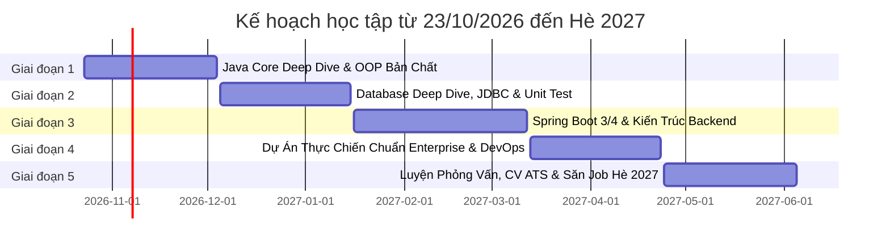

# LỘ TRÌNH CHINH PHỤC JOB INTERN / FRESHER JAVA BACKEND (HÈ 2027)

> **Mục tiêu:** Trúng tuyển vị trí **Java Backend Intern hoặc Fresher** tại các tập đoàn và công ty công nghệ (Viettel, Vingroup/VinFast, FPT, Rikkeisoft, KMS, VNPay, ZaloPay, các Software Studio & Product Company...) vào mùa tuyển dụng Hè 2027 (tháng 5 - 7/2027).  
> **Thời gian:** 32 tuần (~7.5 tháng), bắt đầu từ **23/10/2026** đến **đầu tháng 06/2027**.  
> **Kim chỉ nam:** *"Học sâu bản chất, không học vẹt bề nổi. Kiến thức nào chắc ngay kiến thức đó. Đi từ gốc rễ JVM, OS, Database đến Framework."*

---

## 🧭 TỔNG QUAN CÁC CHẶNG ĐƯỜNG (ROADMAP PHASES)

---

## GIAI ĐOẠN 1: JAVA CORE DEEP DIVE & BẢN CHẤT HỆ THỐNG
*Thời gian: 6 tuần (23/10/2026 – 04/12/2026)*  
*Mục tiêu: Nắm vững cơ chế chạy của Java, quản lý bộ nhớ, 4 tính chất OOP từ gốc rễ, và cấu trúc dữ liệu nền tảng.*

### 1. Cơ chế thực thi & Vùng nhớ JVM (Tuần 1)
- [ ] Luồng biên dịch: `.java` ➔ `javac` ➔ Bytecode (`.class`) ➔ ClassLoader ➔ JIT Compiler / Interpreter ➔ CPU.
- [ ] Bộ nhớ trong JVM:
  - **Stack Memory:** Lưu trữ gì? Stack frame, local primitives, references. Cơ chế LIFO, `StackOverflowError`.
  - **Heap Memory:** Lưu trữ gì? Objects, Arrays, String Pool. Cơ chế cấp phát, `OutOfMemoryError: Java heap space`.
- [ ] Pass-by-value trong Java (Tại sao Java 100% là Pass-by-value, kể cả khi truyền Object?).
- [ ] Wrapper classes, Autoboxing/Unboxing và nguy cơ tiềm ẩn về hiệu năng (`NullPointerException`, memory overhead).

### 2. Bốn tính chất OOP từ góc độ thiết kế & bộ nhớ (Tuần 2 - 3)
- [ ] **Encapsulation (Đóng gói):**
  - Không chỉ là getter/setter: Bảo vệ bất biến (Class Invariants), Information Hiding.
  - Lỗ hổng rò rỉ tham chiếu (**Reference Leak**) với Mutable Objects.
  - Kỹ thuật **Defensive Copying** và Unmodifiable Collections.
- [ ] **Inheritance (Kế thừa):**
  - Cơ chế constructor chaining (`super()`), thứ tự cấp phát bộ nhớ khi khởi tạo lớp con.
  - Phân tích: Tại sao thực tế ưu tiên *Composition over Inheritance* (Tổng hợp hơn Kế thừa)?
- [ ] **Polymorphism (Đa hình):**
  - Compile-time polymorphism (Method Overloading) vs Runtime polymorphism (Method Overriding).
  - Bản chất dưới máy ảo JVM: Dynamic Method Dispatch & Bảng ảo (**vtable**).
  - Từ khóa `super`, `this`, giới hạn của method hiding (`static`).
- [ ] **Abstraction (Trừu tượng):**
  - `Abstract Class` vs `Interface`: Khi nào dùng cái nào? (IS-A vs CAN-DO, chia sẻ mã nguồn vs hợp đồng giao tiếp).
  - Tính năng của Interface trong Java hiện đại: `default method`, `static method`, `private method`.
  - Giới thiệu triết lý thiết kế SOLID (đặc biệt là Single Responsibility & Open/Closed Principle).

### 3. Java Collections Framework Internals (Tuần 4 - 5)
- [ ] Phân tích độ phức tạp thời gian/bộ nhớ: `ArrayList` (Dynamic Array, mảng nhân đôi) vs `LinkedList` (Node liên kết đôi, Cache locality).
- [ ] **HashMap Deep Dive (Câu hỏi phỏng vấn kinh điển):**
  - Cấu trúc: Bucket array, Hash function, Hash collision (Xung đột băm).
  - Chuyển đổi từ LinkedList sang Red-Black Tree (từ Java 8 khi vượt ngưỡng threshold = 8).
  - Hợp đồng `equals()` và `hashCode()`: Tại sao override `equals` bắt buộc phải override `hashCode`?
- [ ] `HashSet`, `TreeSet`, `TreeMap` (nguyên lý sắp xếp bằng `Comparable` và `Comparator`).
- [ ] Khái niệm Immutability (Bất biến): `String` Pool, tại sao `String` bất biến? Phân biệt `String`, `StringBuilder`, `StringBuffer`.

### 4. Modern Java & Xử lý nâng cao (Tuần 6)
- [ ] Generics: Type Erasure, Wildcards (`? extends T`, `? super T` - PECS Rule).
- [ ] Exception Handling: Checked vs Unchecked Exception, cấu trúc `try-with-resources`, cơ chế đóng tài nguyên `AutoCloseable`.
- [ ] Java 8 -> 21 Features:
  - Functional Interface, Lambda Expressions, Method References.
  - Stream API: Khác biệt giữa Intermediate operations (Lazy evaluation) và Terminal operations.
  - `Optional` (dùng đúng cách để tránh lạm dụng), `record`, `sealed classes`.
- [ ] **Thuật toán song hành:** 20+ bài LeetCode Easy/Medium (Array, String, HashMap, Two Pointers, Sliding Window).

🎯 **Sản phẩm đầu ra Giai đoạn 1:**
- Xây dựng 1 ứng dụng quản lý/mô phỏng hướng đối tượng thuần Java Core (Console application) chuẩn SOLID, không rò rỉ tham chiếu, xử lý Exception chặt chẽ và có Custom Data Structure (tự viết lại một mini `MyHashMap` hoặc `MyArrayList`).

---

## GIAI ĐOẠN 2: DATABASE DEEP DIVE, JDBC & TESTING BÀI BẢN
*Thời gian: 6 tuần (05/12/2026 – 15/01/2027)*  
*Mục tiêu: Làm chủ cơ sở dữ liệu quan hệ (RDBMS), tư duy tối ưu truy vấn, kiểm thử tự động (Unit Test).*

### 1. Cơ sở dữ liệu quan hệ & SQL nâng cao (Tuần 7 - 8)
- [ ] Hệ quản trị: PostgreSQL hoặc MySQL.
- [ ] Chuẩn hóa dữ liệu (1NF, 2NF, 3NF), thiết kế schema thực tế (E-commerce / Booking: Users, Orders, OrderItems, Products, Payments).
- [ ] SQL chuyên sâu:
  - Các loại JOIN (INNER, LEFT, RIGHT, FULL, CROSS) và cơ chế xử lý dữ liệu.
  - Aggregate functions, GROUP BY, HAVING, Subquery, Common Table Expressions (CTE), Window Functions (`ROW_NUMBER`, `RANK`).
- [ ] ACID & Quản lý giao dịch (Transactions):
  - Transaction Isolation Levels (Read Uncommitted, Read Committed, Repeatable Read, Serializable).
  - Các hiện tượng: Dirty Read, Non-repeatable Read, Phantom Read.

### 2. Tối ưu hóa Database (Index & Query Optimization) (Tuần 9)
- [ ] **Database Indexing:**
  - Cấu trúc B-Tree / B+Tree của Index.
  - Clustered Index (Chỉ mục cụm) vs Non-Clustered Index.
  - Composite Index và quy tắc tiền tố dài nhất (Leftmost Prefix Rule).
  - Khi nào NÊN và KHÔNG NÊN đánh index?
- [ ] Đọc và phân tích `EXPLAIN ANALYZE` để tìm điểm nghẽn (Table Scan vs Index Scan / Index Seek).

### 3. Java Database Connectivity (JDBC) & Build Tools (Tuần 10)
- [ ] Maven: Quản lý dependencies, lifecycle (`compile`, `test`, `package`), file `pom.xml`.
- [ ] JDBC Core: `DriverManager`, `Connection`, `Statement`, `PreparedStatement` (phòng chống SQL Injection), `ResultSet`.
- [ ] Connection Pooling: Tại sao mở/đóng kết nối liên tục lại phá hủy hiệu năng? Tìm hiểu **HikariCP**.

### 4. Kiểm thử tự động (Unit Testing & Mocking) (Tuần 11 - 12)
- [ ] Triết lý Testing: Test Pyramid (Unit -> Integration -> E2E).
- [ ] **JUnit 5:** Lifecycle (`@BeforeEach`, `@Test`, `@ParameterizedTest`), Assertions.
- [ ] **Mockito:** Mock dependencies, Stubbing (`when().thenReturn()`), Verify hành vi (`verify()`), Argument Captor.
- [ ] Thực hành TDD (Test-Driven Development) cơ bản: Viết test trước khi code nghiệp vụ.
- [ ] **Thuật toán song hành:** Stack, Queue, Singly/Doubly Linked List, Binary Search.

🎯 **Sản phẩm đầu ra Giai đoạn 2:**
- Ứng dụng Java + JDBC thuần kết nối PostgreSQL, có Connection Pool, có transaction rollback khi lỗi, kèm bộ Unit Test độ phủ code > 80% bằng JUnit 5 & Mockito.

---

## GIAI ĐOẠN 3: SPRING BOOT CHUYÊN SÂU & KIẾN TRÚC BACKEND
*Thời gian: 8 tuần (16/01/2027 – 12/03/2027)*  
*Mục tiêu: Nắm trọn bản chất Spring Framework (không chỉ biết dùng annotation), xây dựng RESTful API chuẩn Enterprise.*

### 1. Spring Framework Core Internals (Tuần 13 - 14)
- [ ] **Inversion of Control (IoC) & Dependency Injection (DI):**
  - Tại sao cần IoC? Phân biệt Field Injection, Setter Injection, Constructor Injection (tại sao Constructor Injection được khuyến nghị?).
  - `ApplicationContext` vs `BeanFactory`.
- [ ] **Spring Bean Lifecycle:**
  - Các bước từ lúc quét (`@ComponentScan`), khởi tạo, inject dependencies, `@PostConstruct`, đến `@PreDestroy`.
  - Bean Scopes: `singleton` (mặc định và vấn đề thread-safety), `prototype`.
- [ ] **Spring AOP (Aspect-Oriented Programming):**
  - Bản chất: Dynamic Proxy (JDK Dynamic Proxy vs CGLIB).
  - Tự viết Custom Annotation đo thời gian thực thi (Logging/Metric).
  - Cơ chế hoạt động ngầm của `@Transactional` (Bẫy gọi nội bộ self-invocation khiến transaction mất tác dụng).

### 2. Spring Boot & RESTful API chuẩn quốc tế (Tuần 15 - 16)
- [ ] Cơ chế Spring Boot Auto-Configuration (`@EnableAutoConfiguration`, `spring.factories` / `AutoConfiguration.imports`).
- [ ] Thiết kế REST API:
  - Phân tầng chuẩn: Controller ➔ Service ➔ Repository ➔ Entity/DTO.
  - Sử dụng đúng HTTP Methods (GET, POST, PUT, PATCH, DELETE) và Status Codes (200, 201, 204, 400, 401, 403, 404, 409, 500).
- [ ] DTO Pattern, MapStruct để mapping đối tượng.
- [ ] Validation: Bean Validation API (`@NotNull`, `@Size`, `@Email`, custom validator).
- [ ] Global Exception Handling: `@RestControllerAdvice` + `@ExceptionHandler` chuẩn cấu trúc lỗi RFC 7807 / Standard API Error Response.

### 3. Spring Data JPA & Hibernate Deep Dive (Tuần 17 - 18)
- [ ] Hibernate Entity States: *Transient, Persistent/Managed, Detached, Removed*.
- [ ] Quan hệ thực thể: `@OneToOne`, `@OneToMany`, `@ManyToOne`, `@ManyToMany`.
- [ ] **Hiểm họa kinh điển trong JPA:**
  - Vấn đề **N+1 Query**: Nhận diện và cách xử lý triệt để (`JOIN FETCH`, `@EntityGraph`).
  - `FetchType.LAZY` vs `FetchType.EAGER` (Tại sao không bao giờ nên dùng EAGER?).
  - `CascadeType` và `orphanRemoval`.
- [ ] Phân trang và sắp xếp: `Pageable`, `Page<T>` vs `Slice<T>` (sự khác biệt về chi phí đếm tổng bản ghi `COUNT(*)`.

### 4. Security & Caching (Tuần 19 - 20)
- [ ] **Spring Security 6:**
  - Kiến trúc `SecurityFilterChain`, các Filter mặc định.
  - Cơ chế Authentication vs Authorization.
  - Triển khai **Stateless Authentication bằng JWT** (Access Token + Refresh Token).
  - Phân quyền theo Role/Permission (`@PreAuthorize`).
- [ ] **Redis Caching:**
  - Cache-Aside Pattern.
  - Tích hợp Spring Cache (`@Cacheable`, `@CachePut`, `@CacheEvict`).
  - Xử lý Cache Invalidation và TTL.
- [ ] API Documentation: Tích hợp OpenAPI 3 / Swagger UI.

🎯 **Sản phẩm đầu ra Giai đoạn 3:**
- REST API Service hoàn chỉnh có Security, JWT, Phân quyền, JPA tối ưu không bị N+1, tích hợp Redis cache và tài liệu Swagger rõ ràng.

---

## GIAI ĐOẠN 4: DỰ ÁN THỰC CHIẾN CHUẨN DOANH NGHIỆP & DEVOPS
*Thời gian: 6 tuần (13/03/2027 – 23/04/2027)*  
*Mục tiêu: Xây dựng dự án "Key Project" đưa vào CV, đủ độ phức tạp và chiều sâu kỹ thuật để cạnh tranh suất Fresher.*

### 1. Ý tưởng & Thiết kế hệ thống (Tuần 21 - 22)
*Gợi ý đề tài:* **Hệ thống Đặt vé / Flash-sale E-commerce / Nền tảng Học trực tuyến LMS đa người dùng.**
- [ ] Thiết kế Database Schema chuẩn hóa, đánh index cho các trường tìm kiếm/lọc thường xuyên.
- [ ] Vẽ biểu đồ luồng: Use-Case Diagram, ERD (Entity Relationship Diagram), Sequence Diagram cho các luồng thanh toán / xử lý đơn hàng phức tạp.
- [ ] Xử lý vấn đề đồng thời (Concurrency): Tránh bán quá số lượng vé/hàng (Over-selling) bằng **Pessimistic / Optimistic Locking** hoặc Redis Distributed Lock.

### 2. Tích hợp Message Queue & Async Processing (Tuần 23)
- [ ] Xử lý bất đồng bộ (`@Async`, Virtual Threads của Java 21).
- [ ] Tích hợp Message Broker: **RabbitMQ** hoặc **Apache Kafka** cơ bản:
  - Bắn sự kiện gửi email thông báo khi đăng ký/đặt hàng thành công.
  - Xử lý hàng đợi thanh toán/hoàn tất giao dịch.

### 3. Containerization & CI/CD Pipeline (Tuần 24 - 25)
- [ ] **Docker:**
  - Viết `Dockerfile` nhiều tầng (Multi-stage build) tối ưu dung lượng image của ứng dụng Spring Boot.
  - Viết `docker-compose.yml` để khởi chạy đồng thời: Web App + PostgreSQL + Redis + RabbitMQ.
- [ ] **CI/CD:**
  - Tạo GitHub Actions workflow: Tự động chạy build, chạy test khi có Pull Request mới.
- [ ] **Deploy thực tế:**
  - Đưa dự án lên Cloud (VPS cá nhân / Render / Railway / AWS Free Tier).
  - Có domain/URL live thực tế để nhà tuyển dụng có thể click trải nghiệm ngay trên CV.

### 4. Đóng gói & Hoàn thiện Repository (Tuần 26)
- [ ] Viết file `README.md` chuyên nghiệp:
  - Kiến trúc hệ thống, Tech stack, Database Schema (ảnh ERD).
  - Hướng dẫn cài đặt nhanh bằng 1 lệnh `docker compose up`.
  - Kết quả benchmark hiệu năng / tải (dùng JMeter hoặc k6).
- [ ] **Thuật toán song hành:** Cây (Binary Tree, BST), BFS/DFS, Đệ quy, Dynamic Programming cơ bản (LeetCode Medium).

🎯 **Sản phẩm đầu ra Giai đoạn 4:**
- 1 Repository GitHub sạch đẹp, code chất lượng cao, commit chuẩn Conventional Commits, có CI/CD, có đường link chạy thực tế.

---

## GIAI ĐOẠN 5: LUYỆN PHỎNG VẤN, TỐI ƯU CV & ỨNG TUYỂN HÈ 2027
*Thời gian: 6 tuần (24/04/2027 – 05/06/2027)*  
*Mục tiêu: Đạt tỷ lệ pass phỏng vấn cao nhất, đàm phán offer tốt.*

### 1. Xây dựng hồ sơ ứng tuyển (CV chuẩn ATS) (Tuần 27)
- [ ] CV chuẩn 1 trang (One-page Resume) tiếng Anh và tiếng Việt.
- [ ] Trình bày dự án theo mô hình **STAR (Situation - Task - Action - Result)**:
  - Thay vì viết: *"Viết API thanh toán"*
  - Viết: *"Thiết kế và tối ưu module thanh toán với Spring Boot & Redis, xử lý 500+ req/s, giảm thời gian phản hồi từ 350ms xuống 85ms bằng cách tối ưu Index Database và Caching."*
- [ ] Tối ưu LinkedIn và GitHub Profile (ghim các repo nổi bật).

### 2. Bộ câu hỏi phỏng vấn cốt lõi (Mock Interview) (Tuần 28 - 29)
- [ ] **Java Core:**
  - Bộ nhớ Heap/Stack, GC hoạt động thế nào?
  - Cơ chế nội tại của `HashMap`, xung đột hash, `equals` & `hashCode`?
  - Khác nhau giữa Abstract Class & Interface trong Java 8/11/17/21?
- [ ] **Database & JPA:**
  - Index B-Tree hoạt động ra sao? Khi nào index bị vô hiệu hóa?
  - Transaction Isolation Levels & Dirty Read / Phantom Read?
  - Lỗi N+1 trong Hibernate là gì, khắc phục bằng cách nào?
- [ ] **Spring Boot:**
  - Vòng đời của một Bean trong Spring?
  - `@Transactional` hoạt động dưới nền tảng AOP như thế nào?
  - Stateless JWT vs Stateful Session?

### 3. Nộp hồ sơ & Chinh phục phỏng vấn (Tuần 30 - 32)
- [ ] Lập danh sách công ty mục tiêu theo đợt tuyển dụng Hè:
  - **Tập đoàn lớn / Chương trình Tài năng:** Viettel Digital Talent, Vingroup/VinFast, FPT IS / FPT Software.
  - **Công ty Outsourcing / Product uy tín:** Rikkeisoft, KMS Technology, NashTech, TMA, VNG, ZaloPay, One Mount, MoMo.
- [ ] Nộp hồ sơ hàng loạt (Target 20-30 công ty để có 5-10 lịch phỏng vấn).
- [ ] Rút kinh nghiệm ngay sau mỗi buổi phỏng vấn: Ghi chú lại câu hỏi chưa trả lời xuất sắc để đào sâu ngay tối hôm đó.
- [ ] Nhận Offers và lựa chọn môi trường phát triển tốt nhất cho kỳ thực tập Hè 2027!

---

## 📌 NGUYÊN TẮC HÀNG NGÀY CHO BẠN
1. **Không copy-paste code không hiểu:** Từng dòng code bạn gõ vào IDE phải trả lời được câu hỏi: *"Tại sao dùng cách này mà không dùng cách khác?"*
2. **Commit đều đặn:** Xanh tài khoản GitHub mỗi ngày để chứng minh kỷ luật tự giác.
3. **Giữ nhịp giải thuật:** 1-2 bài LeetCode mỗi ngày, tập trung hiểu cách tư duy thay vì nhớ lời giải.
